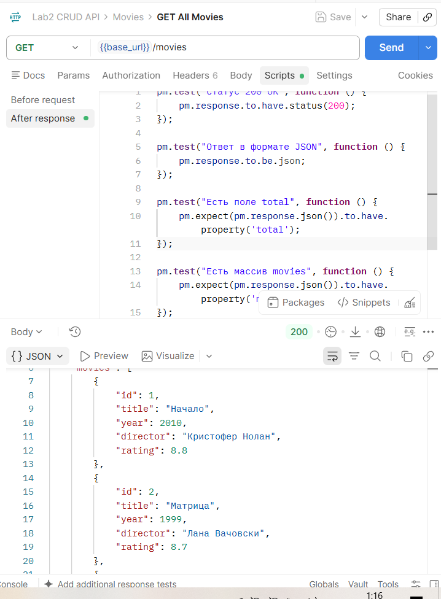
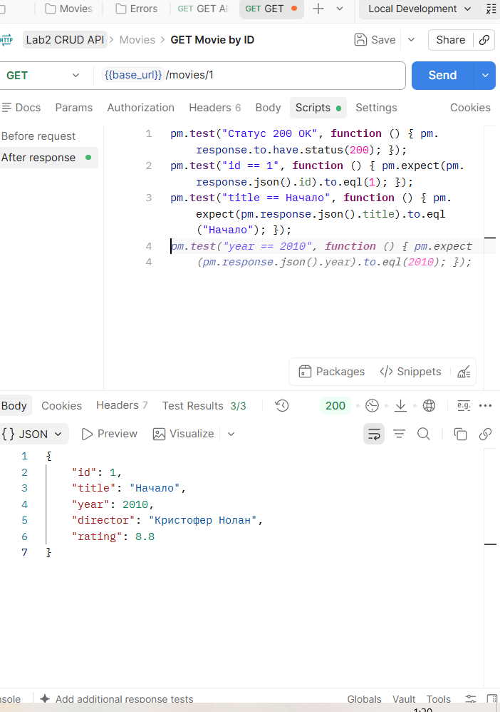
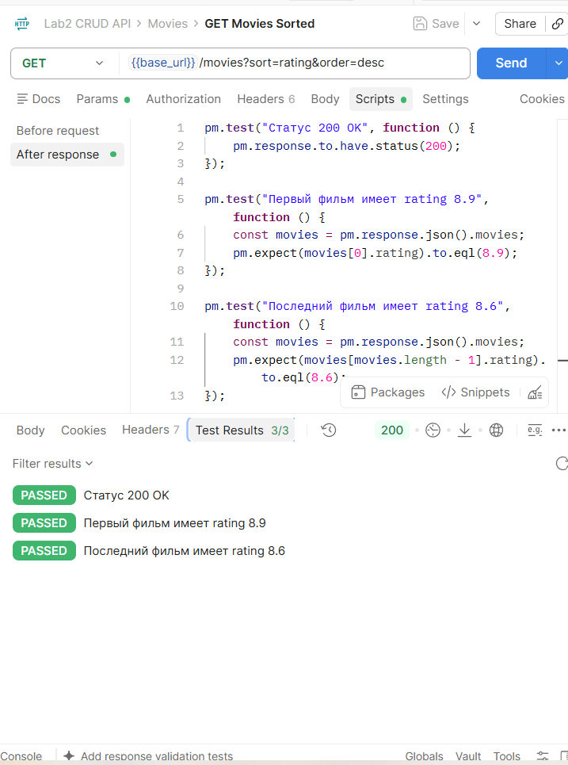
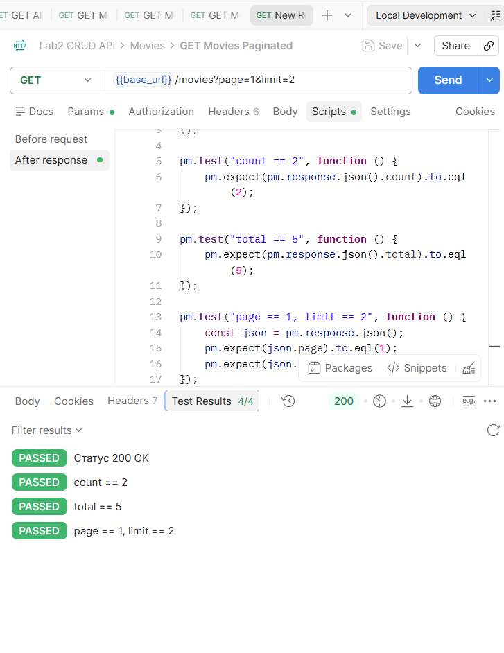
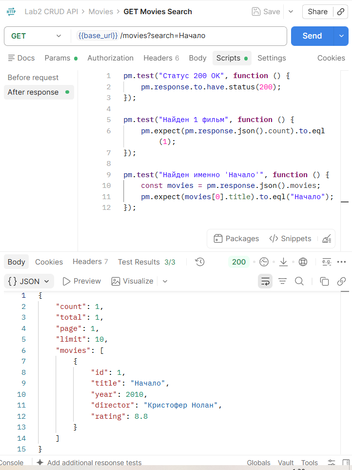
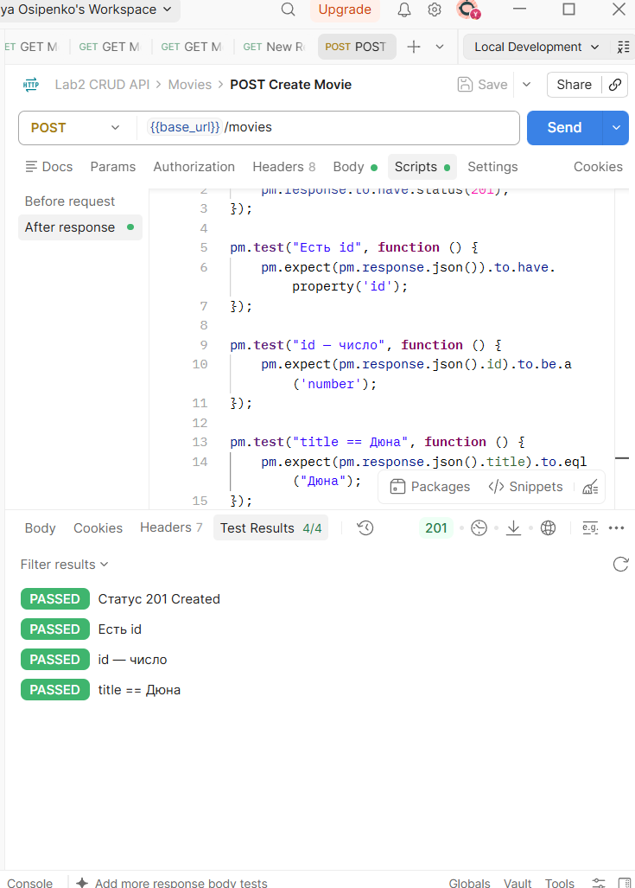
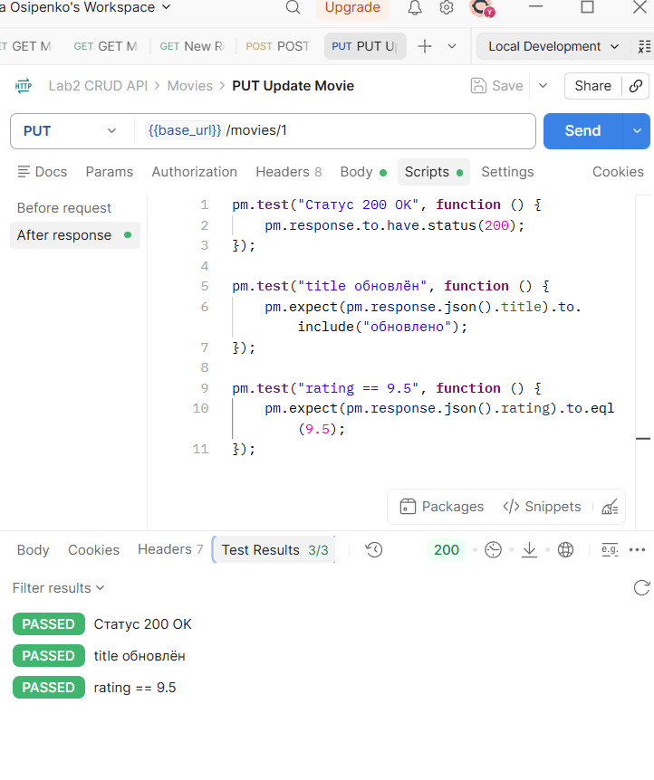
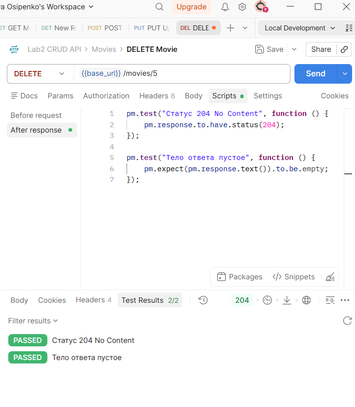

# Лабораторная работа №2: CRUD-операции и HTTP-методы 

**Студент:** Осипенко Юлия Юрьевна  
**Группа:** ПИЖ-б-о-25-1  
**Вариант:** 5  
**Сущность:** Фильмы (movies)  
**Технология:** Node.js + Express

---

## Содержание

- [Лабораторная работа №2: CRUD-операции и HTTP-методы](#лабораторная-работа-2-crud-операции-и-http-методы)
  - [Содержание](#содержание)
  - [Цель работы](#цель-работы)
  - [Теоретическое обоснование](#теоретическое-обоснование)
  - [Выполнение практического примера](#выполнение-практического-примера)
    - [Код сервера](#код-сервера)
  - [Выполнение индивидуального задания](#выполнение-индивидуального-задания)
    - [Код сервера](#код-сервера-1)
  - [Контрольные вопросы](#контрольные-вопросы)
  - [Вывод](#вывод)
  - [Список использованных источников](#список-использованных-источников)

---

## Цель работы

Освоить обработку HTTP-методов (GET, POST, PUT, PATCH, DELETE) в Express. Научиться реализовывать CRUD-операции над коллекцией объектов, хранящейся в памяти сервера, возвращать корректные HTTP-коды (200, 201, 204, 400, 404, 500), а также реализовывать массовые операции, статистику, частичное обновление, логирование в файл и глобальный обработчик ошибок.

---

## Теоретическое обоснование

**CRUD** — акроним четырёх базовых операций над данными: **C**reate (POST), **R**ead (GET), **U**pdate (PUT/PATCH), **D**elete (DELETE).

**HTTP-методы:**
| Метод | Назначение | Идемпотентный |
|-------|-----------|---------------|
| GET | Получение данных | Да |
| POST | Создание ресурса | Нет |
| PUT | Полное обновление | Да |
| PATCH | Частичное обновление | Нет |
| DELETE | Удаление | Да |

**Коды состояния:** 200 OK, 201 Created, 204 No Content, 400 Bad Request, 404 Not Found, 500 Internal Server Error.

**Хранение данных в памяти:** массив объектов, теряется при перезапуске сервера, подходит только для разработки/обучения.

---

## Выполнение практического примера

### Код сервера 

```javascript
const express = require("express");
const app = express();
const port = 3000;

// Middleware для парсинга JSON из тела запроса
app.use(express.json());

// Middleware для логирования запросов
app.use((req, res, next) => {
  console.log(`[${new Date().toISOString()}] ${req.method} ${req.url}`);
  next();
});

// ============ ХРАНИЛИЩЕ ДАННЫХ В ПАМЯТИ ============
let items = [
  { id: 1, name: "Товар 1", price: 100, quantity: 5 },
  { id: 2, name: "Товар 2", price: 200, quantity: 3 },
  { id: 3, name: "Товар 3", price: 300, quantity: 10 },
];

// Счётчик для генерации новых ID
let nextId = 4;

// ============ CRUD-ОПЕРАЦИИ ============

// GET /items — получить все элементы
app.get("/items", (req, res) => {
  res.json({
    count: items.length,
    items: items,
  });
});

// GET /items/:id — получить один элемент
app.get("/items/:id", (req, res) => {
  const id = parseInt(req.params.id);
  const item = items.find((i) => i.id === id);

  if (!item) {
    return res.status(404).json({ error: "Элемент не найден" });
  }

  res.json(item);
});

// POST /items — создать новый элемент
app.post("/items", (req, res) => {
  const { name, price, quantity } = req.body;

  // Валидация: обязательные поля
  if (!name || price === undefined) {
    return res.status(400).json({
      error: "Поля name и price обязательны",
    });
  }

  const newItem = {
    id: nextId++,
    name: name,
    price: price,
    quantity: quantity || 0,
  };

  items.push(newItem);

  // 201 Created — ресурс создан
  res.status(201).json(newItem);
});

// PUT /items/:id — обновить элемент
app.put("/items/:id", (req, res) => {
  const id = parseInt(req.params.id);
  const index = items.findIndex((i) => i.id === id);

  if (index === -1) {
    return res.status(404).json({ error: "Элемент не найден" });
  }

  const { name, price, quantity } = req.body;

  // Полное обновление
  items[index] = {
    id: id,
    name: name || items[index].name,
    price: price !== undefined ? price : items[index].price,
    quantity: quantity !== undefined ? quantity : items[index].quantity,
  };

  res.json(items[index]);
});

// DELETE /items/:id — удалить элемент
app.delete("/items/:id", (req, res) => {
  const id = parseInt(req.params.id);
  const index = items.findIndex((i) => i.id === id);

  if (index === -1) {
    return res.status(404).json({ error: "Элемент не найден" });
  }

  const deletedItem = items.splice(index, 1)[0];

  // 200 OK с удалённым элементом
  res.json({
    message: "Элемент удалён",
    deleted: deletedItem,
  });
});

// ============ ОБРАБОТКА 404 ============
app.use((req, res) => {
  res.status(404).json({ error: "Маршрут не найден" });
});

// ============ ЗАПУСК СЕРВЕРА ============
app.listen(port, () => {
  console.log(`Сервер запущен на http://localhost:${port}`);
});
```

---

## Выполнение индивидуального задания

### Код сервера 

```javascript
const express = require('express');
const app = express();
const port = 3000;

app.use(express.json());

app.use((req, res, next) => {
  console.log(`[${new Date().toISOString()}] ${req.method} ${req.url}`);
  next();
});

// ============ ХРАНИЛИЩЕ ДАННЫХ ============
let movies = [
  { id: 1, title: 'Начало', year: 2010, director: 'Кристофер Нолан', rating: 8.8 },
  { id: 2, title: 'Матрица', year: 1999, director: 'Лана Вачовски', rating: 8.7 },
  { id: 3, title: 'Интерстеллар', year: 2014, director: 'Кристофер Нолан', rating: 8.6 },
  { id: 4, title: 'Криминальное чтиво', year: 1994, director: 'Квентин Тарантино', rating: 8.9 },
  { id: 5, title: 'Бойцовский клуб', year: 1999, director: 'Дэвид Финчер', rating: 8.8 }
];

let nextId = 6;

// ============ ВАЛИДАЦИЯ ============
function validateMovie(body, isUpdate = false) {
  const errors = [];
  const { title, year, director, rating } = body;

  if (!isUpdate || title !== undefined) {
    if (!title || typeof title !== 'string' || title.trim() === '') {
      errors.push('Поле "title" обязательно и должно быть непустой строкой');
    }
  }
  if (!isUpdate || year !== undefined) {
    if (year === undefined || typeof year !== 'number' || isNaN(year)) {
      errors.push('Поле "year" обязательно и должно быть числом');
    }
  }
  if (!isUpdate || director !== undefined) {
    if (!director || typeof director !== 'string' || director.trim() === '') {
      errors.push('Поле "director" обязательно и должно быть непустой строкой');
    }
  }
  if (!isUpdate || rating !== undefined) {
    if (rating === undefined || typeof rating !== 'number' || isNaN(rating)) {
      errors.push('Поле "rating" обязательно и должно быть числом');
    } else if (rating < 0 || rating > 10) {
      errors.push('Поле "rating" должно быть в диапазоне от 0 до 10');
    }
  }

  return errors;
}

// ============ CRUD ============

// GET /movies – все фильмы (поиск, сортировка, пагинация)
app.get('/movies', (req, res) => {
  let result = [...movies];
  const { search, sort, order, page, limit } = req.query;

  // Поиск по названию
  if (search) {
    const s = search.toLowerCase();
    result = result.filter(m => m.title.toLowerCase().includes(s));
  }

  // Сортировка
  if (sort) {
    const sortOrder = order === 'desc' ? -1 : 1;
    if (result.length > 0 && result[0].hasOwnProperty(sort)) {
      result.sort((a, b) => {
        if (a[sort] < b[sort]) return -1 * sortOrder;
        if (a[sort] > b[sort]) return 1 * sortOrder;
        return 0;
      });
    } else {
      return res.status(400).json({ error: `Невозможно сортировать по полю "${sort}"` });
    }
  }

  // Пагинация
  const total = result.length;
  let pageNum = parseInt(page) || 1;
  let limitNum = parseInt(limit) || 10;
  if (pageNum < 1) pageNum = 1;
  if (limitNum < 1) limitNum = 10;

  const start = (pageNum - 1) * limitNum;
  const paginated = result.slice(start, start + limitNum);

  res.json({
    count: paginated.length,
    total: total,
    page: pageNum,
    limit: limitNum,
    movies: paginated
  });
});

// GET /movies/:id – один фильм
app.get('/movies/:id', (req, res) => {
  const id = parseInt(req.params.id);
  const movie = movies.find(m => m.id === id);
  if (!movie) return res.status(404).json({ error: 'Фильм не найден' });
  res.json(movie);
});

// POST /movies – создать фильм
app.post('/movies', (req, res) => {
  const errors = validateMovie(req.body, false);
  if (errors.length > 0) return res.status(400).json({ errors });

  const { title, year, director, rating } = req.body;
  const newMovie = {
    id: nextId++,
    title: title.trim(),
    year: year,
    director: director.trim(),
    rating: rating
  };
  movies.push(newMovie);
  res.status(201).json(newMovie);
});

// PUT /movies/:id – обновить фильм
app.put('/movies/:id', (req, res) => {
  const id = parseInt(req.params.id);
  const index = movies.findIndex(m => m.id === id);
  if (index === -1) return res.status(404).json({ error: 'Фильм не найден' });

  const errors = validateMovie(req.body, true);
  if (errors.length > 0) return res.status(400).json({ errors });

  const { title, year, director, rating } = req.body;
  movies[index] = {
    id: id,
    title: title !== undefined ? title.trim() : movies[index].title,
    year: year !== undefined ? year : movies[index].year,
    director: director !== undefined ? director.trim() : movies[index].director,
    rating: rating !== undefined ? rating : movies[index].rating
  };
  res.json(movies[index]);
});

// DELETE /movies/:id – удалить фильм
app.delete('/movies/:id', (req, res) => {
  const id = parseInt(req.params.id);
  const index = movies.findIndex(m => m.id === id);
  if (index === -1) return res.status(404).json({ error: 'Фильм не найден' });

  movies.splice(index, 1);
  res.status(204).send(); // 204 No Content
});

// 404
app.use((req, res) => {
  res.status(404).json({ error: 'Маршрут не найден' });
});

app.listen(port, () => {
  console.log(`Сервер запущен на http://localhost:${port}`);
});
```

---

**Все запросы через Postman:**

http://localhost:3000/movies - GET — все фильмы



http://localhost:3000/movies/1 - GET с поиском по ID



http://localhost:3000/movies?sort=rating&order=desc - GET с сортировкой



http://localhost:3000/movies?page=1&limit=2 - GET с пагинацией



http://localhost:3000/movies?search=Начало - GET - поиск по названию



http://localhost:3000/movies - POST - создание



http://localhost:3000/movies/1 - PUT - обновление



http://localhost:3000/movies/5 - DELETE - удаление



http://localhost:3000/movies/999 - GET - ошибка 404

.png)

http://localhost:3000/movies - POST - ошибка 400

.png)

---

## Контрольные вопросы 


**1. В чём разница между PUT и PATCH?**  
**PUT** — полная замена ресурса: все поля перезаписываются, отсутствующие становятся `undefined`.  
**PATCH** — частичное обновление: изменяются только переданные поля, остальные сохраняются.

---

**2. Как реализовать поиск по коллекции (query-параметр search)?**  
Прочитать `req.query.search` и отфильтровать массив через `.filter()`:
```javascript
if (search) {
  result = result.filter(r => r.title.toLowerCase().includes(search.toLowerCase()));
}
```

---

**3. Как реализовать сортировку по полю?**  
Прочитать `req.query.sort` и `req.query.order`, затем вызвать `.sort()`:
```javascript
const dir = order === 'desc' ? -1 : 1;
result.sort((a, b) => (a[sort] > b[sort] ? 1 : a[sort] < b[sort] ? -1 : 0) * dir);
```

---

**4. Как реализовать пагинацию (постраничный вывод)?**  
Читаем `page` и `limit`, вычисляем срез через `.slice()`:
```javascript
const p = parseInt(page) || 1;
const l = parseInt(limit) || 10;
result = result.slice((p - 1) * l, p * l);
```
Формула: `start = (page - 1) * limit`, `end = start + limit`.

---

**5. Как валидировать входные данные (например, что price — число)?**  
Проверять через `typeof`:
```javascript
if (typeof price !== 'number') {
  return res.status(400).json({ error: 'price должен быть числом' });
}
```
Дополнительно: `Number.isFinite(price)`, проверка `price > 0`, `!isNaN(price)`.

---

**6. Какие коды ответов используются при ошибках валидации?**  
**400 Bad Request** — клиент прислал некорректные данные (не хватает полей, неверный тип, недопустимое значение).

---

**7. Как вернуть 204 No Content при DELETE?**  
```javascript
recipes.splice(index, 1);
res.status(204).send();   // .send() без аргументов — тело пустое
```


---

**8. В чём разница между `res.json()` и `res.send()`?**  
- **`res.json(obj)`** — сериализует объект в JSON-строку **и автоматически** ставит заголовок `Content-Type: application/json`.  
- **`res.send(data)`** — универсальный: строки → `text/html`, объекты → тоже JSON, но заголовок может отличаться. Для API **предпочтительнее `res.json()`**.

---

**9. Как избежать дублирования ID при создании новых элементов?**  
Использовать **счётчик** `nextId`, который увеличивается при каждом создании:
```javascript
let nextId = 4;           // начинаем после существующих
const newItem = { id: nextId++, ... };
```
`nextId++` — сначала берёт текущее значение, потом увеличивает на 1. Никогда не переиспользует старые ID.

---

**10. Что такое `express.json()` и почему без него `req.body` пустой?**  
**`express.json()`** — встроенный middleware Express, который читает тело запроса с `Content-Type: application/json`, парсит JSON-строку в JS-объект и кладёт результат в `req.body`.  
**Без него** `req.body` = `undefined`, потому что Express по умолчанию **не парсит** тело — это нужно делать явно.

---

## Вывод

Освоила обработку HTTP-методов (GET, POST, PUT, PATCH, DELETE) в Express. Научилась реализовывать CRUD-операции над коллекцией объектов, хранящейся в памяти сервера, возвращать корректные HTTP-коды (200, 201, 204, 400, 404, 500), а также реализовывать массовые операции, статистику, частичное обновление, логирование в файл и глобальный обработчик ошибок.

---

## Список использованных источников

1. Express — Routing: https://expressjs.com/en/guide/routing.html  
2. Express — Request и Response: https://expressjs.com/en/4x/api.html  
3. HTTP-методы (MDN): https://developer.mozilla.org/ru/docs/Web/HTTP/Methods  
4. Коды состояния HTTP (MDN): https://developer.mozilla.org/ru/docs/Web/HTTP/Status  
5. REST API Tutorial: https://restfulapi.net/  
6. Postman Learning Center: https://learning.postman.com/  
7. Node.js `fs` модуль: https://nodejs.org/api/fs.html

